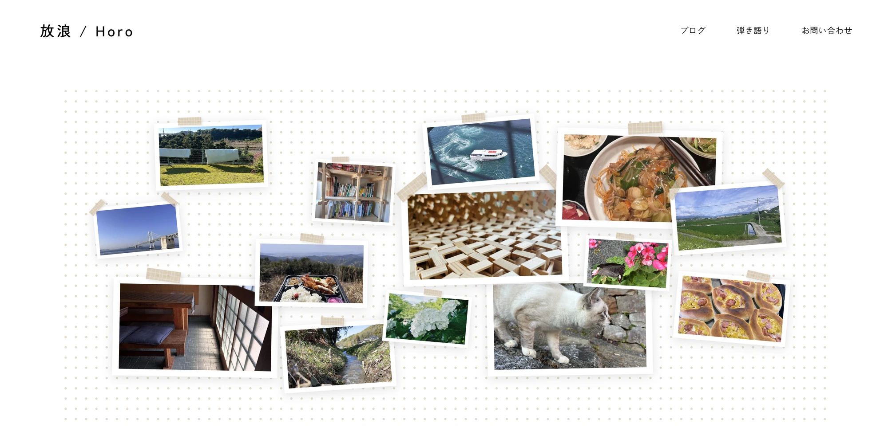

結婚と引っ越しが重なってへとへとになった8月でしたが、少しだけ時間ができたので、妻のブログを作りました。

<LinkCard url="https://horohororo.com/" />

妻の書く文章は言葉がとても綺麗で、読んでいて情景が想像できるくらい読みやすい文章です。 
ずっとnoteでブログを書き残していたのですが、前々から自分のブログが欲しいと言っていたため、良い機会だと思い作ることにしました。

技術スタックとしてはAstroで作っていて、CSSにはPanda CSS、CMSにはmicroCMSを使っています。 
私のサイトはmarkdownで日記を書いていますが、markdownだとなかなかとっつきにくいと思い、CMSを利用しています。
microCMSを使ったブログを作るのは久しぶりでしたが、今は他にもヘッドレスCMSは色々あるんでしょうか。

特にこだわったのはトップページで、記事で使った写真がランダムにボードへ並ぶようにしています。写真からそれぞれの記事に飛ぶこともできて、結構気に入っています。 
妻もとても喜んでくれたので良かった。やはりデザインを考えるのは楽しいなと感じました。

私の一番好きな記事はこれです。よかったら読んでみてください。

<LinkCard url="https://horohororo.com/blog/k03ifq7wyfi" />
