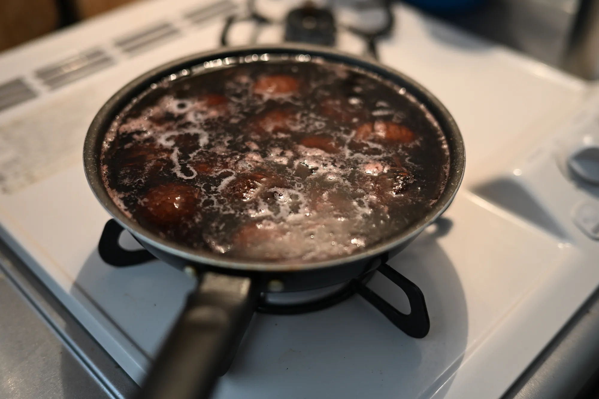
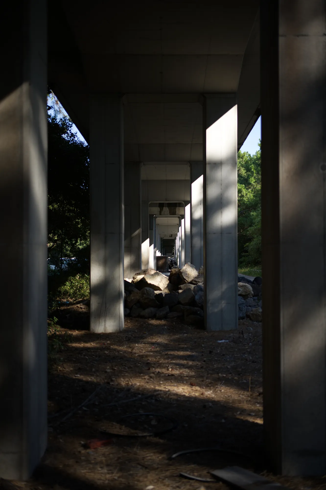
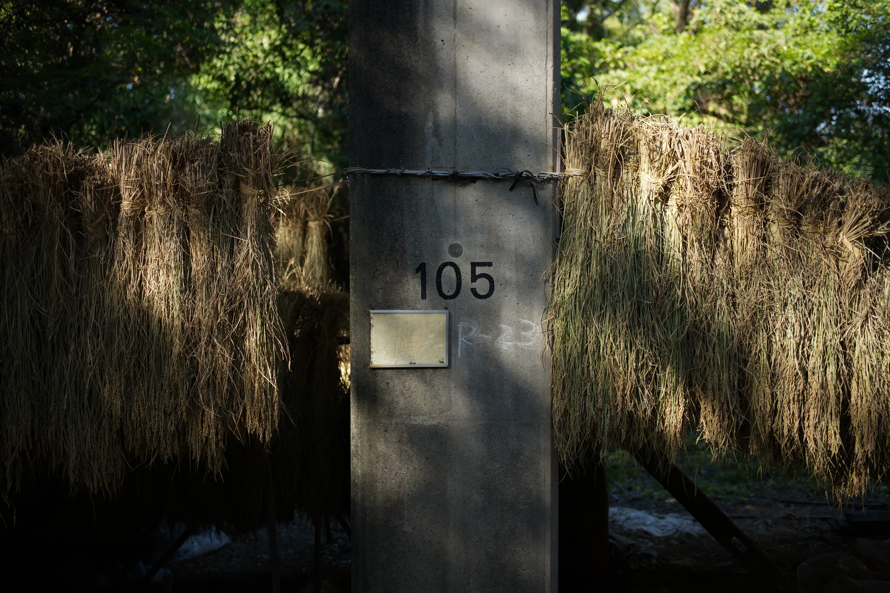

Nikon Zfを購入しました。

<LinkCard url="https://nij.nikon.com/products/lineup/mirrorless/zf/" />

前々から妻と「RICOHのGRが欲しいね」なんて話していたのですが、抽選になかなか当たらなかったのと、そこまで乗り気になれず、買わずに1年、2年と経っていました。 
そこに、たまたまインスタで拝見したデザイン会社のフォトグラファーの方の写真が非常に好みで、同じカメラが欲しくなり、勢いで購入してしまいました。 

高いカメラだけあって、写真も動画も非常に綺麗に撮影することができ、感動しています。 
全くカメラのことがわからない、撮影技術がない状態で試しに撮影してみたのが以下の写真です。

妻が栗の渋皮煮を作っている風景

そこらへんの高架下

柱と干された稲

よくわからないままシャッターを切ってもかっこいい写真が撮れるのでテンションが上がります。 
少しずつ練習して妻との思い出の写真をたくさん残したい。 
商品や風景の写真なども少しずつ練習していきたいと思います。いずれはブログにギャラリーみたいな方で写真載せていきたい。
