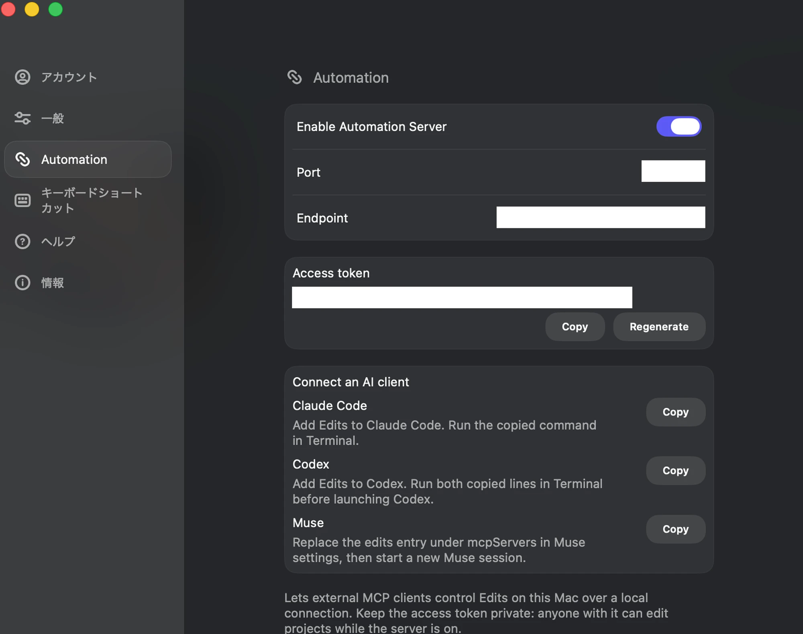
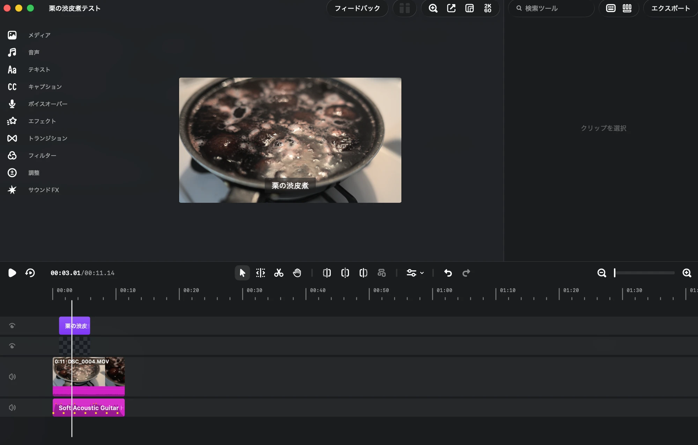

先日、Instagramの動画編集アプリ「Edits」のMac版がリリースされました。

<LinkCard url="https://edits.instagram.com/ja-jp/desktop/" />

モバイルアプリ版との違いは、MCP経由で操作できることです。 
11月10日のAdobe MAXでは、PremiereやPhotoshopも2027年にMCPへ対応すると発表されました。写真や動画の編集アプリをAIから直接操作する流れはこれから広がりそうですが、無料ですぐに試せるという点で、Editsはいい入り口だと思います。

## 接続の手順

Editsの設定から「Automation」を開き、「Enable Automation Server」をオンにします。

「Connect an AI client」のClaude Codeの欄にある「Copy」を押し、コピーされたコマンドをターミナルで実行するだけです。Claude Codeを起動し直すと、Editsを操作できるようになります。

## MCP経由でできること

Editsを操作するためのツールは200個以上あり、カットや並べ替え、テロップ、BGM、字幕の自動生成、色の調整、書き出しまで、普段アプリで手作業している操作はひと通りできるようです。 
BGMのビート位置を取り出してカットしたり、映像に何が映っているかを読み取ったりする機能もあります。

## 活用方法

私の妻は職場でSNS担当をしていて、動画編集をする機会がよくあります。ほかの業務も兼務しているため、なかなか編集に時間を割けず困っていたところに、ちょうどEditsがリリースされました。

妻の場合はまず、Claudeと動画の構成を相談します。どんな流れの動画にするか、どの画角で何を撮るかを一覧にしてもらい、その一覧の通りに撮影します。 
撮った素材をClaudeに渡し、Editsで編集してもらうという流れです。

試しに、私もサンプルの動画を編集してもらいました。

カットやつなぎ、BGMに合わせた画面の切り替え、テロップ入れなどは、手作業でやるより効率的にできると思います。

一方で難しいと感じたのは、編集の知識がないと的確な指示が出せず、意図した通りの仕上がりにならないことです。これは、コーディングやデザインをAIに任せるときと同じですね。 
また、BGMの選曲がいまいちなこともありました。Claudeは曲名や検索語をもとに選んでいるので、ここは人が選んだほうがよさそうです。

写真や動画の編集も、これからAIエージェントによってどんどん効率的で質の高いものになっていきそうです。今後も動向を追いながら、うまく取り入れていきたいと思います。
